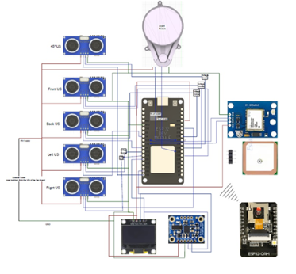
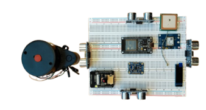
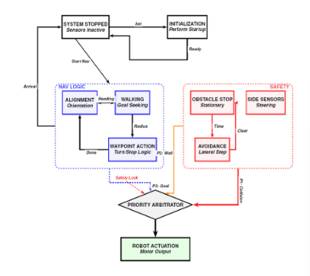
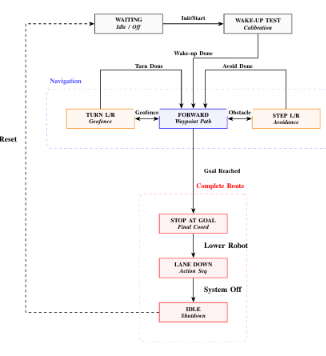

# Go2 Campus Navigation: autonomous GPS/IMU mail delivery with a quadruped robot

An embedded navigation core that lets a **Unitree Go2** quadruped walk autonomously across the campus of the Deggendorf Institute of Technology (DIT), from the post building to a destination building and back, while avoiding static and moving obstacles.

Team project in the case study *Cooperative and Autonomous Systems*, M.Sc. Mechatronic and Cyber-Physical Systems, DIT (2025).

**Result:** the Go2 walked autonomously from the post building (B) to building H, handling interruptions from static and dynamic obstacles, with missions started and monitored from a web dashboard with live camera.

---

## Why this is hard

Most outdoor navigation work targets wheeled robots. A walking robot adds its own problems:

- **Gait oscillation.** The body tilts with every step, so ultrasonic sensors can see the ground as an obstacle.
- **Yaw drift.** Small differences between the legs make the robot drift sideways during straight walking.
- **Poor GPS.** 1 Hz positions, drift between buildings, and no heading when standing still.
- **A closed platform.** The manufacturer software cannot be changed.

The goal was a lightweight, deterministic solution on two ESP32 microcontrollers rather than a heavy learning-based stack.

---

## Hardware

*Wiring of the sensor kit: ESP32 sensor hub, five ultrasonic sensors, GPS, IMU, OLED display and ESP32-CAM.*

*The sensor kit as built for testing.*

| Component | Role |
|---|---|
| ESP32 Dev Module | Sensor hub, navigation and decision logic |
| ESP32-CAM | Web server, live camera stream |
| u-blox NEO-6 GPS | Position at 1 Hz |
| Bosch BNO055 IMU | Absolute orientation at 100 Hz (on-chip sensor fusion) |
| 5 x HC-SR04 ultrasonic | Front, back, left, right, and one at 45° for the turning blind spot |
| OLED display | Local status and current command |
| MCP4728 DAC + MCP23017 I/O expander | Interface to the robot's remote-control input over I²C |

The design also included an LD20 LiDAR in the sensor kit. Obstacle avoidance in the tested system ran on the ultrasonic array.

---

## Navigation

### From GPS to a local frame
GPS coordinates are converted to a local Cartesian frame with a reference point on campus as origin and a scaling factor for the covered area:

$$x = (\text{lon} - \text{lon}_{ref}) \cdot S \qquad y = (\text{lat} - \text{lat}_{ref}) \cdot S$$

A position is only used if the fix is valid and the HDOP is below a threshold. Unreliable fixes never reach the navigation logic.

### Waypoints and geofences
The robot follows a sequence of waypoints. Arrival is detected when the Euclidean distance to the waypoint falls inside its geofence radius. Each geofence can carry its own motion instruction, so the route is guided by the map instead of manual control.

### Heading from the IMU
GPS gives the **target bearing** toward the next waypoint; the IMU gives the **actual heading**. The raw yaw is corrected with a hard-iron offset (motors and chassis) and the local magnetic declination, then normalised to 0 to 360°. The IMU's NDOF calibration status (system, gyroscope, accelerometer, magnetometer) is checked before every mission.

Turns at waypoints use IMU feedback only. The turn command stops at 82° so the robot coasts into the final 90°.

### Routes
The web dashboard offers three missions: **Go to Post**, **Go to H**, and **Return to Post**, plus an alternative walking route for days when snow blocks the main path.

---

## Control architecture

*Navigation logic and safety logic run in parallel; a priority arbiter decides which command reaches the robot.*

*System state machine from wake-up and calibration, through navigation and avoidance, to the final stop and shutdown.*

The controller is a **four-level hierarchical state machine**:

1. **Mode control.** The system only switches from STOPPED to RUNNING when initialisation is complete and the user has confirmed the mission.
2. **Parallel command generation.** Waypoint navigation, ultrasonic obstacle detection and virtual-wall enforcement each produce a candidate command at the same time.
3. **Priority arbitration, safety first:** `STOP > STEP (obstacle) > TURN (geofence) > FORWARD > WAITING`. An avoidance command is held for a lock time so the robot fully clears the obstacle before navigation takes over again.
4. **Actuation.** The final command maps to six motion primitives. If the system is stopped or not initialised, the actuator forces a hardware stop.

### Non-blocking obstacle handling
Ultrasonic echoes take time. Blocking delays would freeze GPS updates and the web server, so the obstacle logic is itself a non-blocking state machine on a 15 ms cycle: **detect** (front obstacle under 75 cm, stop), **decide** (compare left and right clearance), **execute** (side step, timed by timestamps instead of delays). Every reading is median-filtered over three samples, and the IMU tilt is used to ignore false "obstacles" caused by the ground during walking.

---

## Interfaces

- **Web dashboard** hosted on the ESP32-CAM: STOP, H and POST buttons, live camera stream over HTTP, and telemetry from a JSON `/status` endpoint polled every 500 ms.
- **ESP-NOW** carries commands between the ESP32-CAM and the ESP32 sensor hub.
- **THD Map Editor**: a browser tool (HTML5, Leaflet.js) to place waypoints, paths and geofences on satellite images. It exports the map as a JSON array that the C++ firmware reads directly, which keeps map processing off the microcontroller.
- **Robot interface**: the Go2 is controlled without touching its software, by emulating its remote control over I²C. An MCP4728 DAC sets the motion vectors and an MCP23017 triggers posture changes. Motion is limited to 28 % for safety, and every stop resets all channels to their calibrated midpoint.

---

## What the field tests taught us

**Heading drift.** Walking straight, the robot started drifting left after about 5 s.
1. Correcting after every step kept it straight but made it very slow.
2. Correcting every 5 s was smoother, but missed alignments sometimes caused unnecessary full 360° turns.
3. Final solution: correct every 5 s with hysteresis (act above 6°, correct until below 3°) and limit corrections to ±60°. This removed the oscillation and the full turns.

**GPS drift between buildings.** In the passage between buildings D and E the position drifted. A short timed stop before continuing forward solved it for this route.

**Weather.** Tests ran in winter. An alternative route was added for days when snow blocked the main path.

---

## Limitations and next steps

- Navigation depends on GPS outdoors; GPS-denied areas are not covered.
- Waypoints and geofences are hand-placed in the map editor.
- Next steps named in the project: an Extended Kalman Filter for smoother position estimates, visual SLAM from the onboard camera, and a single-board computer (Raspberry Pi or Jetson Nano) for heavier tasks such as object recognition.

---

## Tech

`ESP32` `ESP32-CAM` `C++ (Arduino)` `TinyGPS++` `Adafruit BNO055` `HC-SR04` `ESP-NOW` `I²C` `MCP4728` `MCP23017` `HTML5` `JavaScript` `Leaflet.js` `JSON` `Unitree Go2`

---

*Team project, Deggendorf Institute of Technology, case study Cooperative and Autonomous Systems.*
